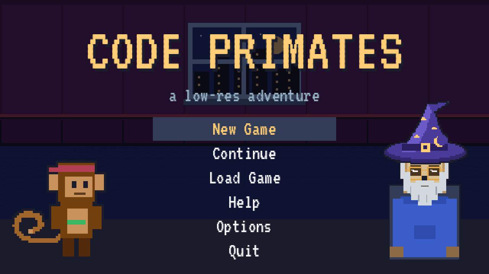
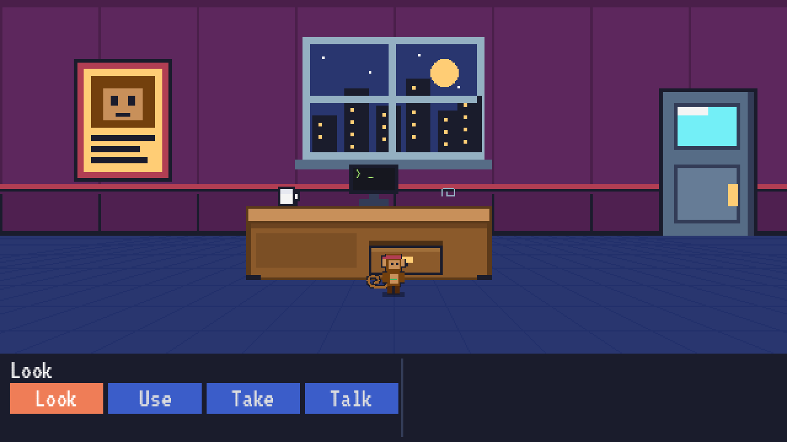
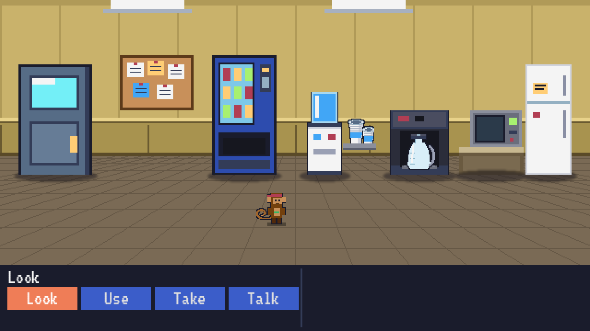
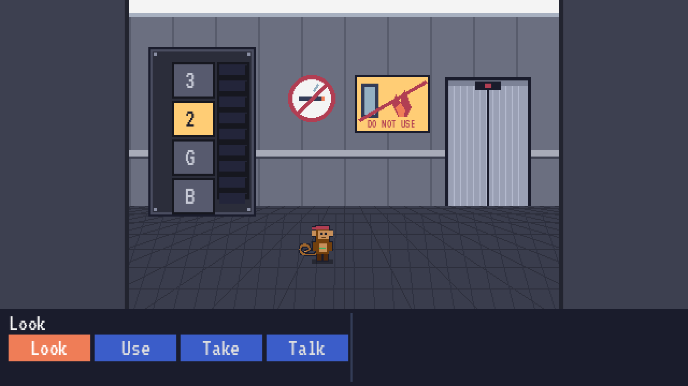
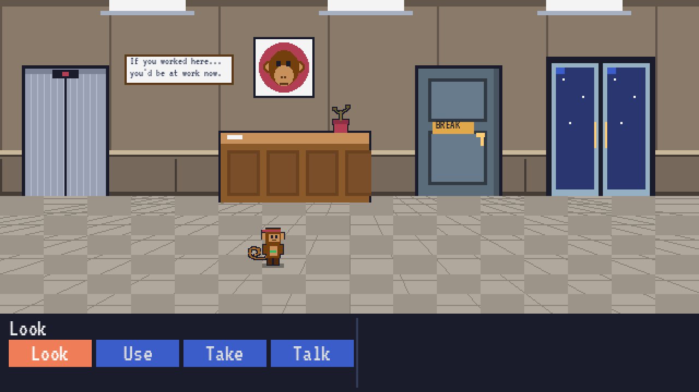
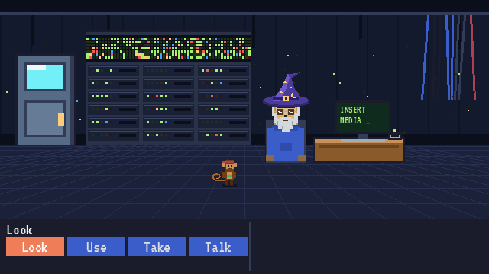

# Code Primates (working title)

A low-res, 8-bit point-and-click adventure about a code monkey, a very long Friday night shift, and a deploy that
has to go out before anyone notices. Look, Use, Take and Talk your way through an office building at night:
four floors, an elevator that hums, a sloth sysadmin in a wizard hat, and more coffee than is strictly healthy.

Made with [Godot](https://godotengine.org) 4 and GDScript. All the art and sound are generated by scripts in `tools/`.

<p align="center">
  
  
</p>
<p align="center">
  
  
</p>
<p align="center">
  
  
</p>

## Play

Download the zip for your system from the Releases page, unzip it, and run it. (The Windows build isn't code-signed, so
Windows may warn you; on Linux, `chmod +x CodePrimates.x86_64` first if it isn't executable.)

Or run it from source with [Godot](https://godotengine.org/download) 4.3 or newer (built with 4.7):

```
godot --path .
```

## How to play

Everything is done with the mouse. Pick a verb (**Look**, **Use**, **Take**, **Talk**), then click a thing. Click the
floor to walk there. To use an item, pick **Use**, click it in your inventory, and then click what to use it on.

| Key | What it does |
|---|---|
| Mouse | Everything |
| Esc | Pause menu: save, load, notes, help, options, quit |
| N | Notes: the clues you've found so far |
| F5 / F9 | Quick save / quick load (slot 1) |
| 1 to 4, Space, Enter | Pick a dialogue choice / read on |

The game autosaves when you change rooms (Continue on the title screen picks up where you left off). Music and sound
can be switched off in Options. Under Help in the menus you'll find all of this again.

## Spoilers

The game is a puzzle game, and the answers are easy to spoil. This page doesn't, but **[SPOILERS.md](SPOILERS.md)** has
a full walkthrough, every code, and the hidden gags. The source code and the tests in `tools/` contain the solutions too.
If you're stuck, **press N** first: the Notes list every clue you've found.

## Build

```
./build.sh              # Linux and Windows zips in build/
./build.sh linux
```

This needs Godot on your `PATH` and the matching export templates installed (Editor, Manage Export Templates).
Pushing a version tag (`git tag v0.1.0 && git push origin v0.1.0`) makes GitHub Actions run the tests, build both zips and
publish a release with them attached (`.github/workflows/release.yml`).
More for developers (tests, art and audio generators, project layout) is in [docs/DEVELOPMENT.md](docs/DEVELOPMENT.md).

## Credits

- Game, art, code, sound effects and all the music (the elevator jazz included): generated by the scripts in `tools/` (the music and sounds are synthesized, in pure Python).
- Font: [VT323](https://fonts.google.com/specimen/VT323) by The VT323 Project Authors (Peter Hull), SIL Open Font License.
- Engine: [Godot](https://godotengine.org) (MIT license).

## License

The code and the generated art and audio are under the [MIT License](LICENSE). The font keeps its own license (see Credits).
